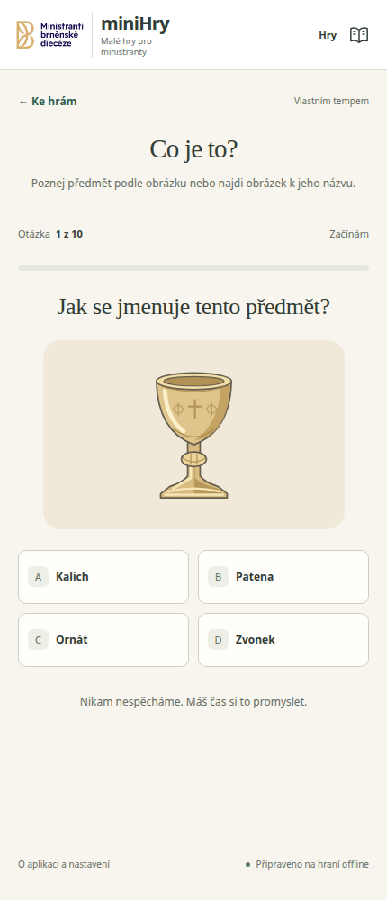

# miniHry

**Malé hry pro ministranty.** Poznávej věci ze sakristie, procvičuj si průběh mše a objevuj liturgický rok. Pro děti přibližně do 12 let, doma i na ministrantské schůzce.

## Zahraj si

**[Spustit miniHry → mrazekv.github.io/minihry](https://mrazekv.github.io/minihry/)**

Stačí otevřít odkaz v prohlížeči na mobilu, tabletu nebo počítači. Bez přihlašování, reklam a sledování. Všechny hry jsou dostupné hned; vybereš si hru, obtížnost a můžeš začít.

## Co si můžeš zahrát

| Hra | Co tě čeká |
| --- | --- |
| **Pexeso ze sakristie** | Hledej dvojice obrázků nebo spoj obrázek s názvem. Vyber si 4, 6 nebo 10 dvojic. |
| **Co je to?** | Poznej předmět podle kresby nebo najdi obrázek k jeho názvu. Tři obtížnosti a deset otázek v každém kole. |
| **Jak jde mše za sebou?** | Seřaď části mše přetahováním nebo šipkami. Od čtyř hlavních částí až po podrobnější průběh. |
| **Cesta liturgickým rokem** | Poskládej období nebo významné svátky a slavnosti. Tři úrovně s liturgickými barvami. |
| **Latina po kapkách** | Spoj známá latinská slovíčka a výrazy s českým významem. |
| **Cesta ke kostelu** | Přeskakuj kaluže a dojdi až ke kostelu. Skákej klepnutím, mezerníkem nebo šipkou nahoru. |

V **obrázkovém slovníčku** najdeš 26 předmětů s kresbou a krátkým vysvětlením. Můžeš si je nejdřív prohlédnout a potom vyzkoušet ve hrách.

## Jak to vypadá

**Nabídka her na počítači**

**Poznávačka na mobilu**

## Vlastním tempem, i bez připojení

Naučné hry nemají časový limit. Když se spleteš, můžeš to zkusit znovu. Obsahují několik obtížností a hraní lze opakovat bez omezení. Skákací hru můžeš kdykoliv pozastavit.

Po prvním úplném načtení lze na podporovaných prohlížečích hrát i bez internetu. Připravenost oznámí text **„Připraveno na hraní offline“** v patičce. Aplikaci si také můžeš přidat na plochu zařízení, pokud to prohlížeč nabízí.

V informacích o aplikaci můžeš omezit animace a obnovit nastavení. Nastavení zůstává pouze v daném zařízení; odpovědi ani historie hraní se neukládají.

## Nápady a zdrojový kód

S nápadem na další hru nebo vylepšení může přijít kdokoliv. **[Napiš ho do GitHub Issues](https://github.com/mrazekv/minihry/issues)**; stejným způsobem můžeš nahlásit chybu.

[Zdrojový kód je dostupný na GitHubu](https://github.com/mrazekv/minihry). miniHry vznikly s pomocí AI asistenta **Codex od OpenAI**. Logo je od ministrantů brněnské diecéze, kresby předmětů jsou vlastní SVG ilustrace.

Pokyny pro lokální spuštění, testování, architekturu a nasazení najdeš v **[dokumentaci pro vývojáře](docs/VYVOJ.md)**.
